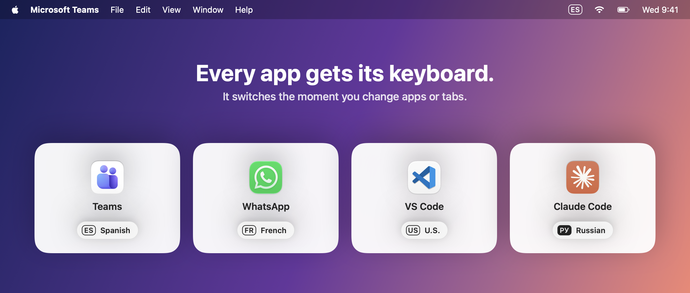

<p align="center">
  
</p>

<h1 align="center">Keyboard Switcher</h1>

<p align="center">
  <strong>The right keyboard in every app. Automatically.</strong><br>
  A tiny Mac menu bar app for people who type in more than one language.
</p>

<p align="center">
  
  
  
  
</p>

<p align="center">
  
</p>

## What it does

- 🪄 **Per app**: Teams in Spanish, WhatsApp in French, VS Code in English, Claude Code in Russian.
- 🌍 **Per website**: `teams.microsoft.com` or `claude.ai` get their own keyboard in Chrome, Brave and Safari.
- 🗣️ **Every language**: 151 languages and 285 keyboards, Japanese, Chinese and Korean included.
- 🧠 **Remembers**: every app and website comes back on the last keyboard you picked in it.
- 🍎 **Looks native**: the menu bar badge is drawn by macOS itself, pixel for pixel.
- 🔒 **Private**: no network, no account, no analytics.
- 🪶 **Tiny**: native Swift, zero dependencies, opens at login.

## Set it once

<table>
  <tr>
    <th>Apps</th>
    <th>Websites</th>
  </tr>
  <tr>
    <td valign="top"></td>
    <td valign="top"></td>
  </tr>
</table>

Or click the badge in the menu bar to set the app or website you're on.

## 151 languages

🇺🇸 🇪🇸 🇫🇷 🇷🇺 🇩🇪 🇮🇹 🇧🇷 🇯🇵 🇨🇳 🇰🇷 🇪🇬 🇮🇱 🇬🇷 🇮🇳 🇺🇦 🇹🇷 🇻🇳 🇹🇭 🇮🇷 🇵🇱 and 131 more.

<details>
<summary><strong>See all 151 languages</strong></summary>

<br>

Every keyboard in System Settings › Keyboard › Input Sources works.
🌐 marks languages spoken across borders, where no single flag fits.

|   |   |   |   |
| :--- | :--- | :--- | :--- |
| 🇯🇵 Ainu | 🇬🇭 Akan | 🇦🇱 Albanian | 🇪🇹 Amharic |
| 🇺🇸 Apache, Western | 🇪🇬 Arabic | 🇦🇲 Armenian | 🇮🇳 Assamese |
| 🌐 Assyrian | 🇦🇿 Azerbaijani | 🇧🇩 Bangla | 🇧🇾 Belarusian |
| 🇮🇳 Bodo | 🇧🇬 Bulgarian | 🇲🇲 Burmese | 🇭🇰 Cantonese, Traditional |
| 🇺🇸 Cherokee | 🇺🇸 Chickasaw | 🇨🇳 Chinese, Simplified | 🇹🇼 Chinese, Traditional |
| 🇺🇸 Chochenyo | 🇺🇸 Choctaw | 🇷🇺 Chuvash | 🇺🇸 Comanche |
| 🇭🇷 Croatian | 🇨🇿 Czech | 🇩🇰 Danish | 🇲🇻 Dhivehi |
| 🇮🇳 Dogri | 🇳🇱 Dutch | 🇧🇹 Dzongkha | 🇺🇸 English |
| 🇪🇪 Estonian | 🇫🇴 Faroese | 🇵🇭 Filipino (Baybayin) | 🇫🇮 Finnish |
| 🇫🇷 French | 🇬🇳 Fula (Adlam) | 🇬🇪 Georgian | 🇩🇪 German |
| 🇬🇷 Greek | 🇬🇵 Guadeloupean Creole | 🇵🇾 Guarani | 🇮🇳 Gujarati |
| 🇭🇹 Haitian Creole | 🇳🇬 Hausa | 🇺🇸 Hawaiian | 🇮🇱 Hebrew |
| 🇮🇳 Hindi | 🌐 Hmong (Pahawh) | 🇭🇺 Hungarian | 🇮🇸 Icelandic |
| 🇳🇬 Igbo | 🇫🇮 Inari Sami | 🇷🇺 Ingush | 🇨🇦 Inuktitut |
| 🇮🇪 Irish | 🇮🇹 Italian | 🇯🇵 Japanese | 🇩🇿 Kabyle |
| 🇧🇷 Kaingang | 🇮🇳 Kannada | 🇮🇳 Kashmiri (Devanagari) | 🇰🇿 Kazakh |
| 🇰🇭 Khmer | 🇷🇺 Kildin Sámi | 🇺🇸 Kiowa | 🇮🇳 Konkani |
| 🇰🇷 Korean | 🌐 Kurdish | 🌐 Kurdish, Sorani | 🇰🇬 Kyrgyz |
| 🇱🇦 Lao | 🇱🇻 Latvian | 🇱🇹 Lithuanian | 🇸🇪 Lule Sami |
| 🇺🇸 Lushootseed | 🇲🇰 Macedonian | 🇮🇳 Maithili | 🇲🇾 Malay (Arabic) |
| 🇮🇳 Malayalam | 🇲🇹 Maltese | 🇮🇶 Mandaic | 🇮🇳 Manipuri (Bangla) |
| 🇮🇳 Manipuri (Meitei Mayek) | 🇳🇿 Māori | 🇮🇳 Marathi | 🇲🇶 Martinican Creole |
| 🇨🇦 Mi’kmaw | 🇲🇳 Mongolian | 🇺🇸 Mvskoke | 🇬🇳 N’Ko |
| 🇺🇸 Navajo | 🇳🇵 Nepali | 🇺🇸 Nez Perce | 🇧🇷 Nheengatu |
| 🇳🇴 North Sámi | 🇳🇴 Norwegian Bokmål | 🇮🇳 Odia | 🇺🇸 Osage |
| 🇦🇫 Pashto | 🇮🇷 Persian | 🇸🇪 Pite Sámi | 🇵🇱 Polish |
| 🇧🇷 Portuguese | 🇮🇳 Punjabi | 🇮🇩 Rejang | 🌐 Rohingya |
| 🇷🇴 Romanian | 🇷🇺 Russian | 🇷🇺 Sakha | 🇺🇸 Salish |
| 🇼🇸 Samoan | 🇮🇳 Sanskrit | 🇮🇳 Santali (Devanagari) | 🇮🇳 Santali (Ol Chiki) |
| 🇷🇸 Serbian | 🇷🇸 Serbian (Latin) | 🇵🇰 Sindhi | 🇮🇳 Sindhi (Devanagari) |
| 🇱🇰 Sinhala | 🇫🇮 Skolt Sami | 🇸🇰 Slovak | 🇸🇮 Slovenian |
| 🇸🇪 South Sámi | 🇪🇸 Spanish | 🇸🇪 Swedish | 🇹🇯 Tajik |
| 🇲🇦 Tamazight, Standard Moroccan (Tifinagh) | 🇮🇳 Tamil | 🇮🇳 Telugu | 🇹🇭 Thai |
| 🌐 Tibetan | 🇹🇴 Tongan | 🇨🇦 Tsuut’ina | 🇹🇷 Turkish |
| 🇹🇲 Turkmen | 🇷🇺 Tuvinian | 🇺🇦 Ukrainian | 🇸🇪 Ume Sámi |
| 🇵🇰 Urdu | 🌐 Uyghur | 🇦🇫 Uzbek (Arabic) | 🇺🇿 Uzbek (Cyrillic) |
| 🇻🇳 Vietnamese | 🇮🇳 Wancho | 🏴󠁧󠁢󠁷󠁬󠁳󠁿 Welsh | 🇲🇽 Wixárika |
| 🇨🇦 Wolastoqey | 🌐 Yiddish | 🇳🇬 Yoruba |   |

Tested by hand: German, Russian, Arabic, Greek, Hebrew and Japanese.

</details>

## Install

```sh
git clone https://github.com/anthonysarkis/keyboard-switcher.git
cd keyboard-switcher
scripts/install.sh
```

Needs macOS 14 or later and Xcode 26 (or its Command Line Tools).
When macOS asks to let it control your browser, click **Allow**: that is how it reads the tab's address.

<details>
<summary><strong>Signing and uninstalling</strong></summary>

<br>

- Your own certificate: `SIGNING_IDENTITY="Apple Development: Your Name (TEAMID)" scripts/install.sh`.
- No certificate: the app is signed "ad hoc" and works the same, but macOS asks for browser access again after each rebuild.
- Uninstall: badge › Quit Keyboard Switcher, delete `~/Applications/Keyboard Switcher.app` and `~/Library/Application Support/com.anthonysarkis.keyboard-switcher`.

</details>

<details>
<summary><strong>How it works</strong></summary>

<br>

1. `NSWorkspace` says which app came to the front.
2. In a browser, Apple Events read the tab's address twice a second, only while you have a website rule.
3. The website rule wins, then the app's rule, then the last keyboard used in that app.
4. `TISSelectInputSource` switches the keyboard.
5. The badge comes from `KLInputSourceIconManager`, the class behind the Mac's own input menu; if a macOS update removes it, the app draws the same badge itself.

Rules live in one small JSON file: `~/Library/Application Support/com.anthonysarkis.keyboard-switcher/rules.json`.

</details>

<details>
<summary><strong>Questions</strong></summary>

<br>

**Firefox?**
App rules work.
Website rules don't: Firefox doesn't share the tab's address with other apps.

**Accessibility or Screen Recording access?**
No.
It only asks to read the current tab, browser by browser, once you add a website rule.

**Will it fight me when I switch by hand?**
No.
It remembers your pick: that app or website gets it back next time.
Turn off "Remember keyboard changes you make yourself" in Settings › General, and only your rules switch the keyboard.

</details>

<details>
<summary><strong>Develop</strong></summary>

<br>

- `swift test`: the rules and the switching engine, with stand-ins for macOS.
- `swift run keyboard-switcher-dev keyboards | switch-test | badges | snapshots <folder>`: live checks.
- `swift run keyboard-switcher-dev readme-images`: redraws the pictures in this README.
- `swift run keyboard-switcher-dev languages`: prints the language table, straight from macOS.
- Logs: `/usr/bin/log show --last 10m --predicate 'subsystem == "com.anthonysarkis.keyboard-switcher" AND process == "KeyboardSwitcher"'`.

</details>
